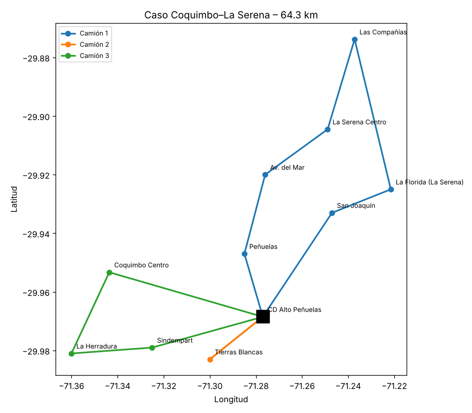
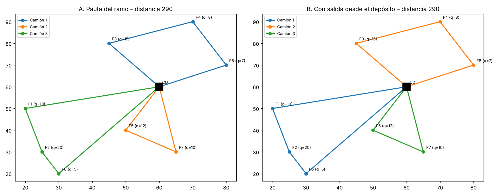

# Ruteo de vehículos con ventanas de tiempo (VRPTW) – reparto a farmacias

Modelo de programación lineal entera para planificar las rutas de una flota que abastece farmacias, respetando la **capacidad de cada camión** y el **horario en que cada farmacia puede recibir**.



## Qué contiene

| Parte | Qué hace | Resultado |
|---|---|---|
| A. Ejercicio del ramo | Replica la ayudantía de Investigación de Operaciones (8 farmacias, 3 camiones, Q = 40) | Distancia óptima **290**, igual a la pauta |
| B. Modelo corregido | Agrega el tiempo de viaje desde el depósito, que la pauta no controlaba | Mismo óptimo, pero con horarios físicamente posibles |
| C. Caso Coquimbo–La Serena | 10 farmacias en sectores reales, distancias haversine × 1,3, 30 km/h, 10 min de descarga | **64,3 km** con 3 camiones (59,1 km con 2) |

El plan de rutas del caso local queda en [`data/plan_rutas_coquimbo.csv`](data/plan_rutas_coquimbo.csv) y el mapa interactivo en `figures/mapa_rutas.html` (descárgalo y ábrelo en el navegador).



## Formulación

- Variables: `x[i,j,k]` binaria (el camión *k* va de *i* a *j*) y `T[k,i]` hora de llegada.
- Objetivo: minimizar la distancia total.
- Restricciones: cada farmacia se visita una vez, cada camión sale y vuelve al depósito, conservación de flujo, capacidad, secuencia de tiempos con *big-M* (elimina subtours) y ventanas de tiempo.

El detalle matemático está en el notebook.

## Tecnología
Python, **PuLP + CBC** (gratis, corre en Colab sin licencia), pandas, matplotlib, folium. La versión original de la ayudantía usaba **Gurobi**; el modelo es el mismo.

## Cómo ejecutarlo

```bash
pip install -r requirements.txt
jupyter notebook notebooks/vrptw_farmacias.ipynb
```

Para adaptarlo a otro caso basta con editar la tabla de puntos (`cd`) en la Parte C: coordenadas, demanda y horario de cada local.

## Limitaciones y siguientes pasos
- Las coordenadas son representativas de cada sector, no direcciones reales de farmacias.
- Las distancias son en línea recta corregidas por 1,3; con una matriz de distancias reales (OSRM, Google Distance Matrix) el modelo queda listo para usarse.
- Para más de ~25 clientes conviene una heurística (por ejemplo, OR-Tools) en vez del modelo exacto.

## Origen
Rehecho a partir de la Ayudantía de Investigación de Operaciones II, Ingeniería Civil Industrial, UCN (2026-1).

**Autor:** Mario Coroseo Ramos
